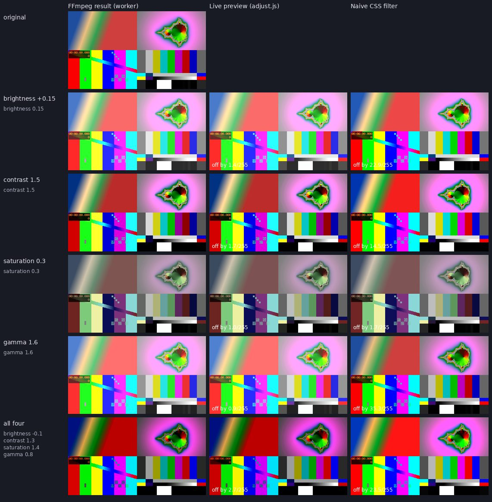
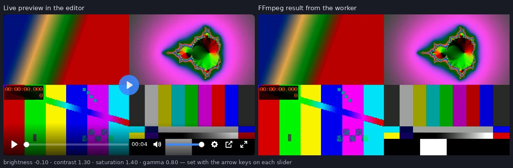

# Track C — colour adjustments (sprint 6)

Brightness, contrast, saturation and gamma: four sliders in the editor, a live
preview on the video while they move, and FFmpeg's `eq` for the result
([`sprint6-plan.md`](sprint6-plan.md) §2.1). Built on the edit-operation seam
([`adding-an-edit-operation.md`](adding-an-edit-operation.md)); nobody else's
code changed beyond the one-line registrations.

| Piece | Where |
|---|---|
| Parameters | `AdjustParams` / `AdjustOperation` in `app/schemas/edit.py` |
| Rule | `register_rule("adjust", …)` in `app/services/media_rules.py` — label `colour`, frame unchanged |
| Filter | `app/worker/edit_ops/adjust.py` — one `eq=` after the tone-map |
| Panel | `frontend/adjust.js` + `adjust.css`, the Colour section in `index.html` |
| Tests | `tests/test_adjust.py` (36), `tests/integration/test_adjust_ffmpeg.py` (3, real FFmpeg), `frontend/adjust.test.js` (21) |

## The contract

```jsonc
{ "operation": "adjust", "params": { "brightness": 0.1, "contrast": 1.2, "saturation": 1.1, "gamma": 1.0 } }
```

- Ranges: brightness −0.3…0.3, contrast 0.5…2, saturation 0…3, gamma 0.5…2.
  Outside them, a 422 that names the field and its range.
- **Every field is optional**; one left out stays as it is. An empty `adjust`
  is a 422. A field left out is stored absent, not `null`.
- Strings, booleans, NaN/∞ and unknown fields are refused (strict schema).
- With MP3 conversion: `colour cannot be combined with MP3 conversion`.

## The filter

`eq=brightness=…:contrast=…:saturation=…:gamma=…` with only the values that
differ from eq's own neutral (0, 1, 1, 1). A request at neutral adds no
filter. It lands in the tone-mapped half of the chain (`registry.py`,
`TONE_MAPPED_FROM = "adjust"`): after crop and scale, after `format=yuv420p`
on an SDR upload, after `tonemap` on an HDR one — so it always works on the
same 8-bit picture the viewer sees.

## The panel

- Four labelled range inputs (step 0.01) with a readout each, and **Reset**.
  Keyboard works as on any slider: arrows, Page Up/Down, Home/End.
- Reports only what was moved off neutral — `{ "contrast": 1.3 }` — and `null`
  once everything is back, so a ticked Colour with nothing moved sends nothing.
- **Moving a slider ticks the section**, so the preview on screen is always
  what Process will send. Unticking takes the preview off; ticking puts it back.
- Cleanup restores the video's own `style.filter` and removes the panel and
  its SVG.

## The preview matches FFmpeg

CSS's `brightness()`, `contrast()` and `saturate()` are not what `eq` does:
`eq` works on Y'CbCr, adds brightness on its 0…1 scale of 8-bit codes, pivots
contrast on the middle code, applies gamma to luma only, and scales chroma for
saturation — and CSS has no gamma at all. So the preview is an SVG filter
(`filter: url(#…)` on the video) that does `eq`'s arithmetic:

1. `feColorMatrix`: R'G'B' → Y'CbCr, BT.709.
2. `feComponentTransfer`: a 256-entry table for Y' — the formula from
   `libavfilter/vf_eq.c` (`create_lut`) on the limited-range codes 16…235 a
   video file actually holds — and one for Cb and Cr (eq's chroma scale).
3. `feColorMatrix`: back to R'G'B'.

`color-interpolation-filters="sRGB"`, because `eq` works on the encoded
values, not linear light.

**Checked against FFmpeg at five settings.** The worker's own command
(`build_edit_command`) was run on an H.264 clip, and its first frame decoded
as BT.709. The real `adjust.js` previewed the same decoded frame in
Chromium. The figures are the mean difference per channel, in 8-bit levels:

| Setting | How much the edit changes the picture | **Preview vs FFmpeg** | Naive CSS vs FFmpeg |
|---|---|---|---|
| brightness +0.15 | 35.7 | **1.4** | 22.9 |
| contrast 1.5 | 14.3 | **1.7** | 14.5 |
| saturation 0.3 | 40.6 | **1.0** | 1.7 |
| gamma 1.6 | 35.3 | **0.9** | 35.3 (no gamma in CSS) |
| all four (−0.1, 1.3, 1.4, 0.8) | 29.3 | **2.7** | 23.5 |

The same arithmetic in numpy, without a browser, is within 0.8–2.1 of
FFmpeg. The rest is FFmpeg working on 4:2:0 chroma, which shows only at hard
colour edges.



## End to end

On a local stack (API, worker and FFmpeg as on AWS):

1. Uploaded a 4-second 720p clip and opened Colour in the editor.
2. Set brightness −0.10, contrast 1.30, saturation 1.40 and gamma 0.80 with
   the arrow keys. The section ticked itself and the preview showed on the
   video.
3. The panel sent
   `{"operation":"adjust","params":{"brightness":-0.1,"contrast":1.3,"saturation":1.4,"gamma":0.8}}`.
4. The worker finished it. The output is 1280×720, `yuv420p`, 4.0 s, sound
   kept. On the first frame, mean luma went from 121.5 to 80.6 and mean
   saturation from 59.0 to 78.0 (`signalstats`).



## Known limits

- **With a preset ticked as well**, the preset's WebGL preview is drawn over
  the video and samples it unfiltered. The colour sliders still apply to the
  result (colour runs before the preset), but the preview then shows only the
  preset.
- **Switch-off** (final week rule): if Colour is not proven on flickpond.com
  by the freeze, add `hidden` to its `<details>` in `index.html`. The API and
  worker side stays harmless with nothing sending it.
